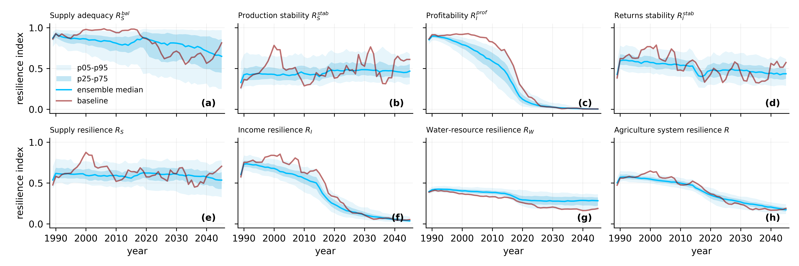
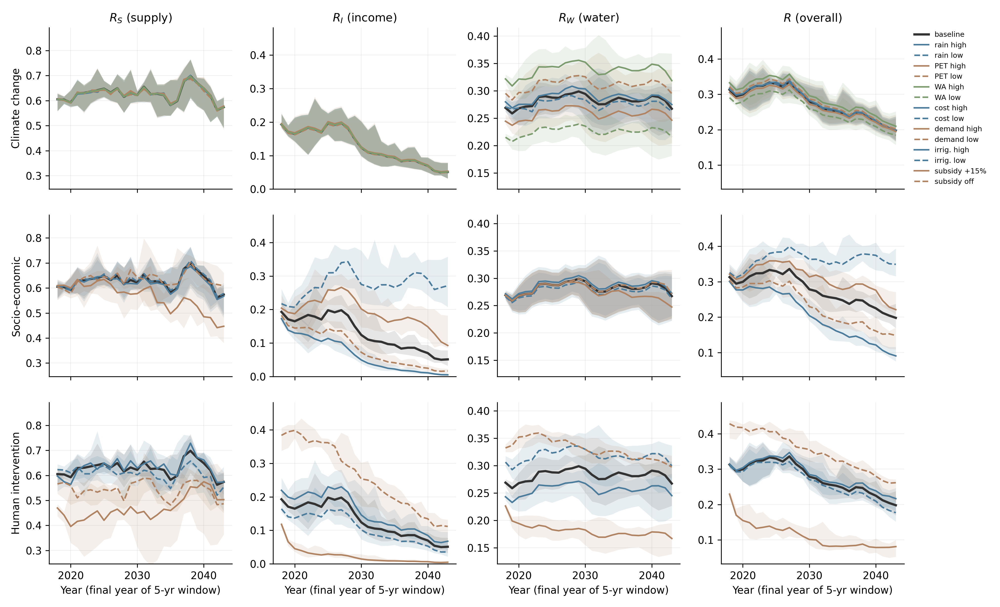

# CAHED — Coupled Agro-Hydro-Economic Dynamics model

[](LICENSE)
[](https://www.python.org/)

CAHED is a parsimonious, modular framework that recursively couples
**agro-hydrological dynamics** with **market-mediated behavioral
responses** in dryland irrigated agriculture, closing the feedback loop
among hydrology, farmer behavior, markets, and policy:

* a stochastic weather generator (Markov-modulated Poisson
  precipitation + sinusoidal PET) drives a daily soil-water balance
  with a stress-avoidance irrigation rule and a Jensen water-stress
  yield function (**agro-hydrological module**);
* aggregate supply clears an isoelastic demand to form an equilibrium
  price; farmers update sown area through an econometrically estimated
  reduced-form Nerlove acreage equation driven by the lagged,
  subsidy-adjusted effective price; a target-price subsidy settles
  farm income and fiscal expenditure (**market-behavioral module**);
* production, water use, and sown area provide the coupling interface
  between the two modules;
* a five-component, bounded **resilience indicator system** (supply
  adequacy, production stability, profitability, profit stability,
  water-demand fulfilment) is aggregated over trailing 5-year windows
  into supply, income, and water-resource dimension indices and an
  overall resilience index.

The demonstration application is **Xinjiang cotton** (China),
calibrated on 1987–2024 observations and simulated over 1985–2045.

* **Manuscript**: Wu et al., "A coupled hydro-economic modeling
  framework for assessing dryland agricultural resilience under climate
  and market uncertainty" (in submission).

## Repository layout

```
CAHED/
├── README.md
├── LICENSE                     MIT
├── requirements.txt
├── config/                     calibrated parameters (single source of truth)
│   ├── model_params.yaml       soil/crop/irrigation, demand, Nerlove,
│   │                           target-price policy, cost dynamics
│   ├── calibration_params.yaml GLUE / econometric calibration settings
│   ├── resilience_params.yaml  indicator normalization parameters,
│   │                           water threshold, ensemble protocol
│   └── scenarios.yaml          14 one-way scenarios + baseline (Text S8)
├── script/                     model code (import as the `script` package)
│   ├── config.py               Config parameter container
│   ├── weather.py              agro-hydrological module: MMPP precipitation,
│   │                           cosine PET (weather generator)
│   ├── soil_water.py           agro-hydrological module: daily water balance,
│   │                           irrigation rule, Jensen yield
│   ├── market.py               market-behavioral module: demand/price,
│   │                           Nerlove acreage, target-price subsidy,
│   │                           recursive coupled loop
│   ├── fast_sim.py             columnar fast implementation for ensembles
│   ├── resilience.py           five-component resilience indicators
│   ├── data_utils.py           bundled-data loaders, run-configuration builder
│   └── utils.py                plotting/export helpers
├── data/
│   ├── raw/                    observations used for calibration/validation
│   │   ├── cahed_xinjiang_annual_panel.csv   NBS/China Cotton Association
│   │   │                                     annual panel, 1978–2024
│   │   ├── data_4_hydro_cali.csv             irrigation (mm) and regional
│   │   │                                     available water (1e8 m3), 1987–2024
│   │   ├── daily_weather_forcing.csv         observed daily precipitation/PET
│   │   │                                     forcing, 1987–2023
│   │   ├── cnrd_monthly_available_water_40-45N_80-90E.csv
│   │   │                                     CNRD monthly water availability
│   │   │                                     climatology (monthly shares)
│   │   ├── cahed_monthly_prices.csv          CC Index monthly prices
│   │   └── cahed_daily_global_price.csv      international cotton prices
│   └── results/                archived paper outputs
│       ├── resilience_indicators.csv         Fig. 6 indicator table
│       ├── resilience_variables.csv          indicator input variables
│       ├── scenario_windowed.csv             15-scenario ensemble
│       ├── scenario_summary.csv              final-window deltas
│       ├── scenario_pairwise_corr.csv        within/cross-scenario Spearman ρ
│       └── scenario_definitions.json         ensemble design + scenario specs
└── example/
    ├── example_fig6_resilience_trajectories.py
    │               reproduce Fig. 6 (resilience indicators, 1985–2045)
    ├── example_fig8_scenarios.py
    │               reproduce the 15-scenario figure (Fig. 8)
    └── output/     figures and recomputed tables written by the examples
```

## Installation

```bash
git clone <this-repository>
cd CAHED
pip install -r requirements.txt
```

No build step is required: the examples add the repository root to
`sys.path` and import the `script` package directly.

## Quick start — reproduce the paper figures

Both examples support three modes: full recomputation (default, exact
paper protocol), `--quick` (reduced ensemble, smoke test), and
`--from-results` (plot the archived tables in `data/results/` without
recomputation).

```bash
# Fig. 6: resilience-indicator trajectories 1985–2045
# (201 coupled simulations, ~4 min on one core)
python example/example_fig6_resilience_trajectories.py

# 15-scenario resilience-indicator trajectories
# (1500 coupled simulations, ~2 min on one core)
python example/example_fig8_scenarios.py
```

Outputs are written to `example/output/`.  The full-protocol
recomputation reproduces the archived paper numbers exactly
(deterministic seeds; e.g. overall-resilience median 0.571 in 1990 and
0.206 in 2040, and the subsidy-plus scenario delta of −0.117).

## Reproduced figures

**Fig. 6 — Trajectories of the resilience indicators, 1985–2045.**
Eight panels: (a–d) the components supply adequacy R_S^bal, production
stability R_S^stab, profitability R_I^prof, and returns stability
R_I^stab; (e–g) the dimension indices supply resilience R_S, income
resilience R_I, and water-resource resilience R_W; (h) the overall
agriculture system resilience R.  Model ensemble (200 members) median
with p25–p75 and p05–p95 bands; the dark-red line is the deterministic
baseline member.  Indicators are 5-year trailing-window scores, plotted
from the first full window (1989) onward.



**15-scenario figure — resilience-indicator trajectories under the
14 one-way scenarios + baseline** (Fig. 8), arranged by driver family:
climate (top row),
socio-economic (middle row), and human intervention (bottom row).
Solid curves denote the high/stronger lever and dashed curves the
low/weaker lever; the black curve and grey ribbon are the baseline
median and IQR.  Ensemble: 100 members per scenario with common random
numbers.  The y-axis of each column is zoomed to the central 98 % of
the pooled scenario values so that the response to each lever remains
visible.



## Minimal API example

```python
from script import (Config, build_baseline_params,
                    generate_precipitation_mmmpp, generate_pet_cosine,
                    merge_weather, simulate_soil_moisture,
                    run_coupled_simulation)
from script import data_utils as du
from script.resilience import (components_from_series,
                               water_annual_score,
                               demand_benchmark_tonnage)

cfg = du.build_run_config(n_years=61, start_year=1985)
bp = build_baseline_params()
weather = merge_weather(generate_precipitation_mmmpp(cfg, bp, seed=2026),
                        generate_pet_cosine(cfg, seed=2026))
soil = simulate_soil_moisture(cfg, weather)
run = run_coupled_simulation(cfg, soil, start_year=1985, policy=True,
                             seed=7, anchor_year=2014)
```

## Requirements

Python ≥ 3.9 with NumPy, pandas, SciPy, PyYAML; Matplotlib for the
examples.  See `requirements.txt`.

## License

MIT (see [LICENSE](LICENSE)).

## Citation

If you use CAHED, please cite the manuscript (link to be added upon
publication) and reference this repository.
